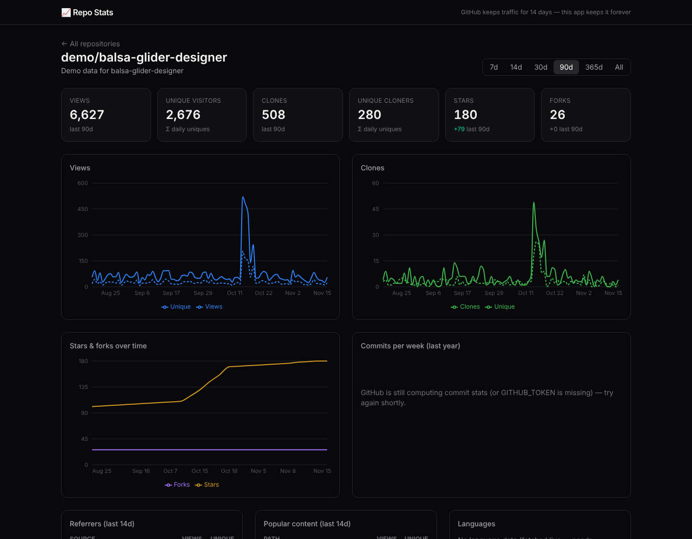

# GitHub Repo Stats

A self-hosted Next.js dashboard for **views, unique visitors, clones, referrers, popular pages, stars, forks and release downloads** across all of your GitHub repositories — with history that goes back further than GitHub's 14-day traffic window.


- **Overview** — totals with % change vs the previous period, daily traffic chart, sortable/filterable repo table with sparklines, top referrers, CSV export.
- **Repo detail** — views & clones (total vs unique), **full star & fork history** (back to repo creation), recent stargazers and forks, referrers, popular content, languages, weekly commits, release downloads.
- Ranges: 7 / 14 / 30 / 90 / 365 days / all time.



_Screenshots use the built-in demo data (`npm run seed:demo`)._

See [PLAN.md](./PLAN.md) for the architecture and roadmap.

## How it works

GitHub's Traffic API only returns the last 14 days. A daily sync job (`/api/cron/sync`, or `npm run sync`) pulls everything and upserts it into Postgres, so your history keeps growing. The dashboard reads only from the database.

## Setup

1. **Token** — create a [fine-grained PAT](https://github.com/settings/personal-access-tokens/new) with *All repositories*, **Administration: Read-only** and **Metadata: Read-only** (or a classic token with `repo`).
2. **Database** — create a free Postgres database (e.g. [Neon](https://neon.tech)).
3. **Configure**
   ```bash
   cp .env.example .env    # fill in GITHUB_TOKEN, DATABASE_URL, CRON_SECRET
   npm install
   npm run db:migrate      # create tables
   npm run sync            # first data pull (also backfills star/fork history)
   npm run dev
   ```

   Want to look around before connecting GitHub? `npm run seed:demo` fills the database with fake repos.

### Postgres options

Neon URLs use the serverless HTTP driver; any other Postgres URL (Railway, Supabase, Docker) uses a regular TCP pool. Override with `DB_DRIVER=neon|pg`.

## Development

```bash
npm test            # unit tests + sync/query integration test on in-memory Postgres (PGlite)
npm run typecheck
npm run build
```

CI runs all three on every push and pull request.

## Deploy (Vercel)

1. Import the repo in Vercel and add the env vars from `.env.example`.
2. `vercel.json` schedules `/api/cron/sync` daily. Vercel sends `Authorization: Bearer $CRON_SECRET` automatically.
3. Set `DASHBOARD_PASSWORD` to put the dashboard behind basic auth.

**Many repos?** Hobby functions time out at 60s. Either raise `maxDuration` (Pro) or use the included GitHub Actions workflow (`.github/workflows/sync.yml`) — add `GH_STATS_TOKEN` and `DATABASE_URL` as repository secrets.

## Stack

Next.js 15 · TypeScript · Tailwind CSS v4 · Recharts · Drizzle ORM · Postgres (Neon or any) · Octokit · Vitest + PGlite
