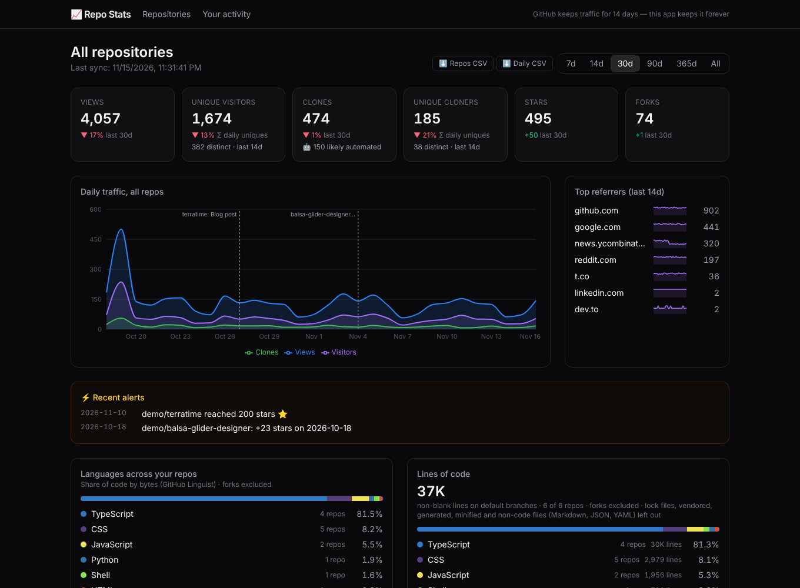
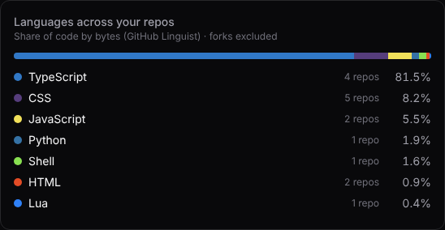
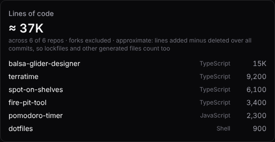
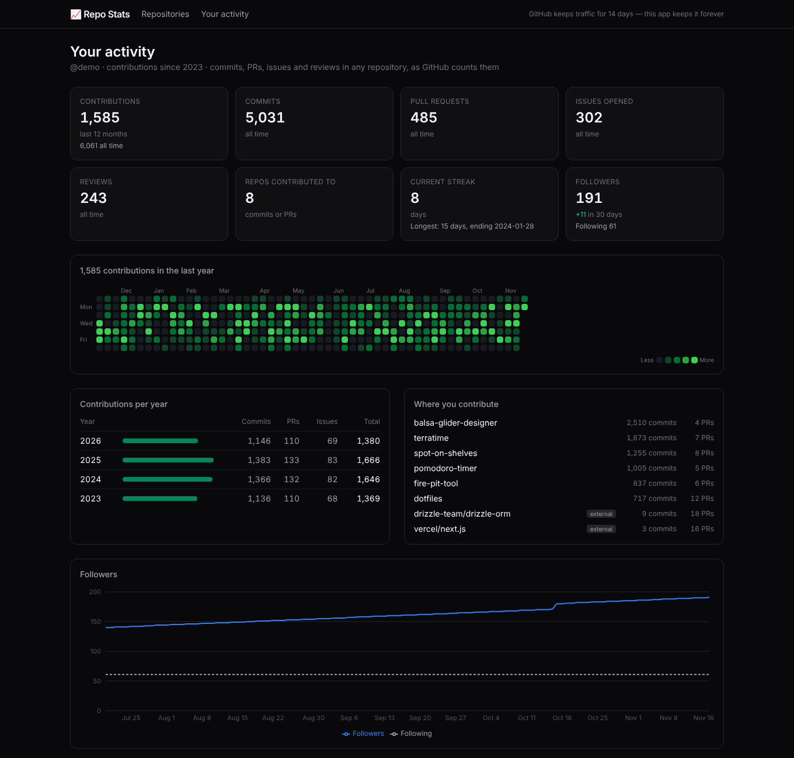
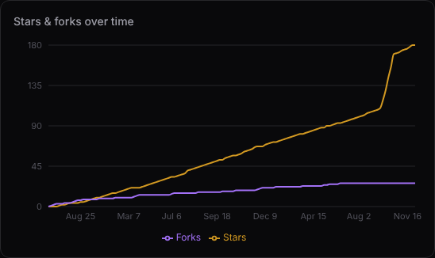
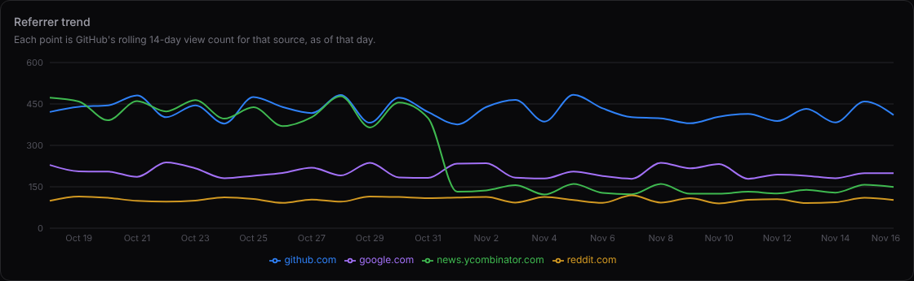
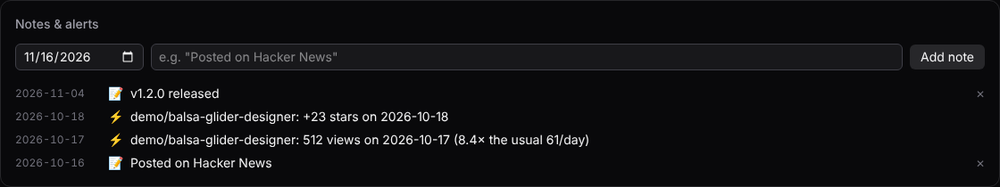

# GitHub Repo Stats

A self-hosted Next.js dashboard for **views, unique visitors, clones, referrers, popular pages, stars, forks and release downloads** across all of your GitHub repositories. It keeps history going back further than GitHub's 14-day traffic window, sends alerts when something takes off, and serves README badges.



<sub>All screenshots use the built-in demo data (`npm run seed:demo`).</sub>

## Features

| | |
|---|---|
| **Overview** | Totals with % change vs the previous period, language and lines-of-code totals, a 🤖 hint on clones that look automated, daily traffic chart, sortable/filterable repo table with sparklines, top referrers with trends, recent alerts, CSV export |
| **Repo detail** | Views & clones (total vs unique), full star & fork history, recent stargazers and forks, referrer trend, popular content, languages, lines of code by language, likely-automated clone hint, weekly commits, code growth (lines added/deleted per month), release downloads |
| **Code** | Languages across all your repos (share of bytes, repos per language) and real lines of code per repo, per language and in total — counted from each repo's default branch with lock files, vendored, generated and non-code files left out, and recounted only when the default branch gets a new commit. Forks are left out of the totals |
| **Your activity** | `/me`: your contributions in any repo, as GitHub counts them — all-time commits, pull requests, issues and reviews, a contribution heatmap with current and longest streak, totals per year, the repos you contribute to most (yours and others'), and follower growth |
| **History** | Traffic is stored daily, so it outlives GitHub's 14-day limit. Star and fork history is rebuilt from GitHub's timestamps, back to the day each repo was created |
| **Alerts** | Traffic spikes, star bursts and star milestones, shown in the app and optionally posted to Slack or Discord |
| **Notes** | Pin notes like "Posted on Hacker News" to a date; they show as markers on the charts |
| **Badges** | `views/month`, `visitors`, `clones`, `stars`, `forks` SVG badges for your READMEs (public repos only) |
| **Ranges** | 7 / 14 / 30 / 90 / 365 days / all time |

### Code across your repos

<table>
<tr>
<td width="50%"><b>Languages</b> — share of code by bytes, and how many repos use each<br></td>
<td width="50%"><b>Lines of code</b> — total, by language and largest repos<br></td>
</tr>
</table>

### Your activity



### Repo detail


<table>
<tr>
<td width="50%"><b>Star & fork history</b> — back to repo creation, even before you installed the app<br></td>
<td width="50%"><b>Referrer trend</b> — where traffic comes from, over time<br></td>
</tr>
<tr>
<td><b>Notes & alerts</b> — your notes plus automatically detected events<br></td>
<td><b>Mobile</b><br></td>
</tr>
</table>

## How it works

GitHub's Traffic API only returns the last 14 days. A daily sync job (`/api/cron/sync`, or `npm run sync`) pulls everything and upserts it into Postgres, so your history keeps growing. The dashboard reads only from the database. After each sync, the alert check looks at yesterday's numbers (the last complete day) and posts anything new to your webhook.

The sync also stores your own contribution history (one GraphQL query per calendar year — the first run backfills every year back to when your account was created, later runs refresh only the current year) and a daily snapshot of your followers.

See [PLAN.md](./PLAN.md) for the architecture, data model and roadmap.

## Setup

1. **Token**: create a [fine-grained PAT](https://github.com/settings/personal-access-tokens/new) with *All repositories*, **Administration: Read-only**, **Contents: Read-only** (release download counts) and **Metadata: Read-only** (or a classic token with `repo`).
   GitHub is restricting the stargazers list to repo admins and collaborators; when it refuses a repo (403), the sync skips that repo's star *history* and says so. Star counts still update.
2. **Database**: create a Postgres database. [Neon](https://neon.tech)'s free tier works well; Railway, Supabase or a local Docker container work too.
3. **Configure and run**
   ```bash
   cp .env.example .env    # fill in GITHUB_TOKEN, DATABASE_URL, CRON_SECRET
   npm install
   npm run db:migrate      # create tables
   npm run sync            # first data pull; also backfills star/fork history
   npm run dev
   ```

Want to look around before connecting GitHub? Run `npm run seed:demo` to fill the database with fake repos.

## Deploy (Vercel)

1. Import the repo in Vercel and add the variables from `.env.example`. Set `DASHBOARD_PASSWORD`: without it, anyone with the URL can see your stats and add notes.
2. `vercel.json` schedules `/api/cron/sync` daily. Vercel sends `Authorization: Bearer $CRON_SECRET` automatically.
3. **First sync:** run `npm run sync` locally once. It backfills full star/fork history with no time limit.

**Time limits:** the cron route collects traffic for every repo first, because GitHub deletes it after 14 days. It then refreshes star/fork history until its time budget (`SYNC_TIME_BUDGET_MS`, default 45s) runs out, and anything left over resumes on the next run. With very many repos you can also raise `maxDuration` (Vercel Pro) or use the included GitHub Actions workflow (`.github/workflows/sync.yml`). For that workflow, add `GH_STATS_TOKEN` and `DATABASE_URL` as repository secrets.

## Alerts

After each sync these are recorded for **yesterday**:

| Alert | Fires when |
|---|---|
| Views spike | views ≥ `ALERT_SPIKE_FACTOR` × the trailing daily average **and** ≥ `ALERT_MIN_VIEWS` |
| Clones spike | same rule for clones, with `ALERT_MIN_CLONES` |
| Star burst | ≥ `ALERT_STAR_BURST` new stars in one day |
| Star milestone | crossing 10, 25, 50, 100, 250, 500, 1k, 2.5k, 5k, 10k… stars |

A repo needs a week of stored history before spikes are judged, so a fresh install doesn't flag everything. Alerts appear on the overview, in each repo's *Notes & alerts* list, and as amber markers on the charts. Each alert is recorded only once, even if the sync runs again.

**Slack / Discord:** create an incoming webhook ([Slack](https://api.slack.com/messaging/webhooks), [Discord](https://support.discord.com/hc/en-us/articles/228383668)) and set `ALERT_WEBHOOK_URL`. Set `APP_URL` too if you want each message to link back to the repo page.

## Notes

Use the form on a repo page to pin a note to a date, such as a launch, a blog post or a release. Notes show as grey markers on that repo's charts and on the overview chart. Hover a marker to read it.

## Badges

```markdown

```

| Badge | Example |
|---|---|
| `?metric=views` (`&range=7` → per week, default 30 → per month) |  |
| `?metric=visitors` (GitHub's deduplicated 14-day uniques) |  |
| `?metric=stars` (also `clones`, `forks`) |  |

Use `&label=…` to change the left-hand text. Badges skip `DASHBOARD_PASSWORD` so GitHub can load them. They only work for **public** repos (private or unknown repos return 404), and are cached for an hour. Set `BADGES_ENABLED=false` to turn them off.

## About lines of code and automated clones

GitHub has no "lines of code" number, so the sync counts them itself: it streams the tarball of each repo's default branch (nothing is written to disk) and counts **non-blank lines** in code files. Left out:

- **Lock files** (`package-lock.json`, `yarn.lock`, `pnpm-lock.yaml`, `Cargo.lock`, `poetry.lock`, `go.sum`, …)
- **Vendored and build output** directories at any depth (`node_modules`, `vendor`, `dist`, `build`, `out`, `.next`, `coverage`, `target`, …)
- **Minified files and source maps** (`*.min.js`, `*.map`, or an average line longer than 300 characters), **binaries**, and files over 1 MB
- **Non-code files**: prose and data such as Markdown, JSON, YAML and plain text. Language comes from the file extension (see `src/lib/loc.ts`)
- Anything your `.gitattributes` marks `linguist-generated`, `linguist-vendored` or `linguist-documentation`. It works the other way too: `dist/** -linguist-vendored` counts a directory back in, and `*.inc linguist-language=PHP` changes the language

A repo is only re-downloaded when its default branch has a new commit, so pushes to other branches cost one API call. Repos larger than 500 MB are skipped. Counting needs the token's **Contents: Read-only** permission. The language bars still show GitHub's Linguist byte counts next to the line counts.

GitHub doesn't say who viewed or cloned a repo, so there is no way to separate people from bots. The 🤖 hint is a heuristic: a repo with at least 10 clones and more than twice as many clones as views in the selected range is flagged, because CI runs, mirrors and deploy hosts (Vercel and Netlify clone on every build) clone without ever opening the page.

## About "unique" numbers

GitHub reports unique visitors per day, and separately, deduplicated over its 14-day window. The big number on the cards adds up daily uniques over the selected range, so someone visiting on 3 days counts 3 times. The "distinct · last 14d" line underneath is GitHub's deduplicated figure from the latest sync.

## Configuration

All variables are listed with comments in [`.env.example`](./.env.example).

| Variable | Required | Purpose |
|---|---|---|
| `GITHUB_TOKEN` | ✅ | Token used to read your repos and traffic |
| `DATABASE_URL` | ✅ | Postgres connection string |
| `CRON_SECRET` | ✅ | Protects `/api/cron/sync` |
| `DASHBOARD_PASSWORD` | recommended | HTTP basic auth for the dashboard and notes (any username) |
| `APP_URL` | | Public URL, for links in alert messages |
| `ALERT_WEBHOOK_URL` | | Slack/Discord webhook for alerts |
| `ALERTS_ENABLED` | | `false` turns alert detection off (default `true`) |
| `ALERT_SPIKE_FACTOR` | | Spike threshold vs trailing average (default `3`) |
| `ALERT_MIN_VIEWS` | | Minimum views for a views spike (default `25`) |
| `ALERT_MIN_CLONES` | | Minimum clones for a clones spike (default `10`) |
| `ALERT_STAR_BURST` | | Stars in one day for a star burst (default `5`) |
| `BADGES_ENABLED` | | `false` disables `/api/badge` (default `true`) |
| `DB_DRIVER` | | `neon` or `pg`. Auto-detected: `*.neon.tech` uses Neon's HTTP driver, anything else uses TCP |
| `DB_POOL_MAX` | | Max TCP connections for non-Neon Postgres (default `5`) |
| `SYNC_TIME_BUDGET_MS` | | Cron sync time budget before deferring history backfills (default `45000`) |

## Scripts

| Command | What it does |
|---|---|
| `npm run dev` / `npm run build` / `npm start` | Next.js dev server / production build / production server |
| `npm run sync` | Run the collector once (no time limit) |
| `npm run db:migrate` | Apply migrations in `drizzle/` |
| `npm run db:generate` | Create a new migration after changing `src/lib/db/schema.ts` |
| `npm run db:push` | Push the schema directly without migrations (prototyping only) |
| `npm run seed:demo` | Fill the database with fake demo repos |
| `npm run screenshots` | Regenerate the screenshots and badge samples in `docs/` (see below) |
| `npm test` / `npm run test:watch` | Unit tests plus integration tests on in-memory Postgres (PGlite) |
| `npm run lint` | ESLint |
| `npm run typecheck` | TypeScript |

## HTTP routes

| Route | Auth | Purpose |
|---|---|---|
| `/` | dashboard password | Overview (`?range=7\|14\|30\|90\|365\|all`) |
| `/repo/:owner/:name` | dashboard password | Repo detail and notes |
| `/me` | dashboard password | Your contributions, streaks and followers |
| `/api/export` | dashboard password | CSV: `?kind=repos\|daily&range=…` |
| `/api/cron/sync` | `Bearer CRON_SECRET` | Run the sync (Vercel Cron) |
| `/api/badge/:owner/:name` | public (public repos only) | SVG badge |

## Development

```bash
npm test && npm run lint && npm run typecheck && npm run build
```

CI runs all four on every push and pull request.

### Keeping the docs current

- `tests/docs.test.ts` fails CI if this README is missing an environment variable from `.env.example`, an npm script, an API route, or a screenshot it links to. Update the README in the same change as the code.
- After UI changes, regenerate the screenshots from demo data so they never show real stats:
  ```bash
  npm run seed:demo && npm run build && npm start   # in one terminal
  npm run screenshots                               # in another
  ```
  This needs a Chromium: run `npx playwright install chromium` once, or set `CHROME_CHANNEL=chrome` to use an installed Chrome.
- Update the roadmap in [PLAN.md](./PLAN.md) when a milestone ships.

## Stack

Next.js 15 · TypeScript · Tailwind CSS v4 · Recharts · Drizzle ORM · Postgres (Neon or any) · Octokit · Vitest + PGlite · Playwright (screenshots)
