# GitHub Repo Stats

A self-hosted Next.js dashboard for **views, unique visitors, clones, referrers, popular pages, stars, forks and release downloads** across all of your GitHub repositories. It keeps history going back further than GitHub's 14-day traffic window, sends alerts when something takes off, and serves README badges.


<sub>All screenshots use the built-in demo data (`npm run seed:demo`).</sub>

## Features

| | |
|---|---|
| **Overview** | Totals with % change vs the previous period, issue/PR flow, CI pass rates, open Dependabot alerts, language and lines-of-code totals, a 🤖 hint on clones that look automated, daily traffic chart, sortable/filterable repo table with sparklines, top referrers with trends, recent alerts, CSV export |
| **Repo detail** | Views & clones (total vs unique), full star & fork history, recent stargazers and forks, referrer trend, popular content, languages, lines of code by language, likely-automated clone hint, weekly commits, code growth (lines added/deleted per month), release downloads |
| **Code** | Languages across all your repos (share of bytes, repos per language) and real lines of code per repo, per language and in total — counted from each repo's default branch with lock files, vendored, generated and non-code files left out, and recounted only when the default branch gets a new commit. Forks are left out of the totals |
| **Frameworks & tools** | What each repo is built with — React, Next.js, Django, Tailwind, Prisma, Vitest, Docker, … about 100 frameworks and tools in 10 categories — read from dependency manifests and config files while lines are counted (no extra API calls). Overview shows how many repos use each and the newest version; click one to filter the repo table. Repo pages show them as tags |
| **Your activity** | `/me`: your contributions in any repo, as GitHub counts them — all-time commits, pull requests, issues and reviews, a contribution heatmap with current and longest streak, totals per year, the repos you contribute to most (yours and others'), and follower growth |
| **Code health** | Share of code that is tests (files in test folders or named `*.test` / `*.spec` / `test_*`), repos with tests, TODO/FIXME count, lines of code over time (from a snapshot each time a repo is recounted — history starts when you install this), and frameworks declared a major version behind their latest npm / PyPI release, with the repos affected. Repo pages flag outdated framework tags |
| **Deployments** | Production and preview deploys per week and their success rate, per repo — from the deployments Vercel, Netlify, GitHub Pages and Actions environments report to GitHub |
| **Project activity** | Issues and pull requests opened/closed/merged, median time to close and to merge, what's open now and who your outside contributors are (bots and your team left out); GitHub Actions pass rate, run count and duration per workflow plus recent failures; GitHub's community-health score and checklist (README, license, contributing guide, …) and open Dependabot alerts by severity. In the repo table: health and CI columns and an alerts badge |
| **History** | Traffic is stored daily, so it outlives GitHub's 14-day limit. Star and fork history is rebuilt from GitHub's timestamps, back to the day each repo was created |
| **Alerts** | Traffic spikes, star bursts and star milestones, shown in the app and optionally posted to Slack or Discord. Each repo can be muted or given its own thresholds from its page |
| **Notes & releases** | Pin notes like "Posted on Hacker News" to a date; they show as markers on the charts. GitHub releases are marked automatically (🚀, green) |
| **Badges** | `views/month`, `visitors`, `clones`, `stars`, `forks` SVG badges for your READMEs (public repos only) |
| **Ranges** | 7 / 14 / 30 / 90 / 365 days / all time |

### Code across your repos

<table>
<tr>
<td width="50%"><b>Languages</b> — share of code by bytes, and how many repos use each<br></td>
<td width="50%"><b>Lines of code</b> — total, by language and largest repos<br></td>
</tr>
</table>

### Frameworks & tools

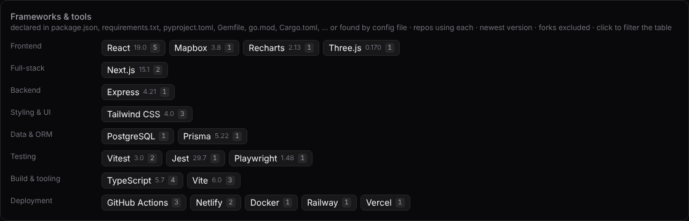

### Code health & deployments

<table>
<tr>
<td width="50%"><b>Code health</b> — tests, TODOs, lines over time, outdated frameworks<br>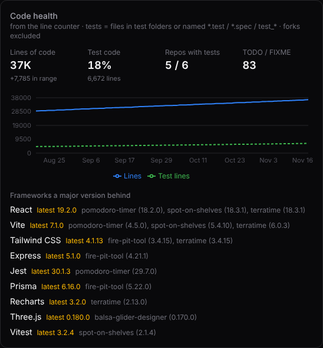</td>
<td width="50%"><b>Deployments</b> — production vs preview, success rate, per repo<br>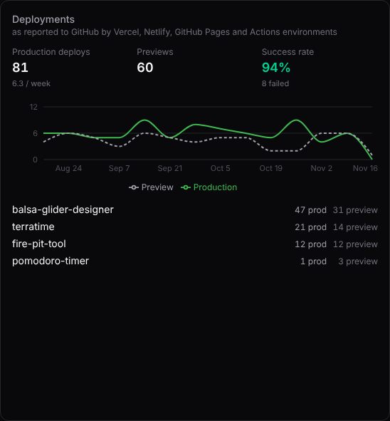</td>
</tr>
</table>

### Your activity


### Project activity

<table>
<tr>
<td width="50%"><b>Issues & pull requests</b> — flow, time to close/merge, outside contributors<br>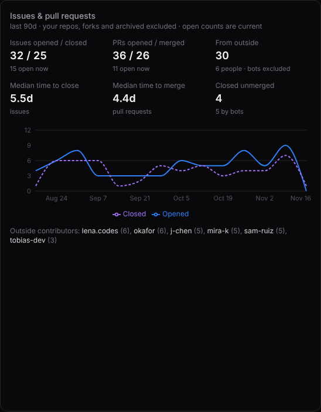</td>
<td width="50%"><b>GitHub Actions</b> — pass rate and duration per workflow, recent failures<br>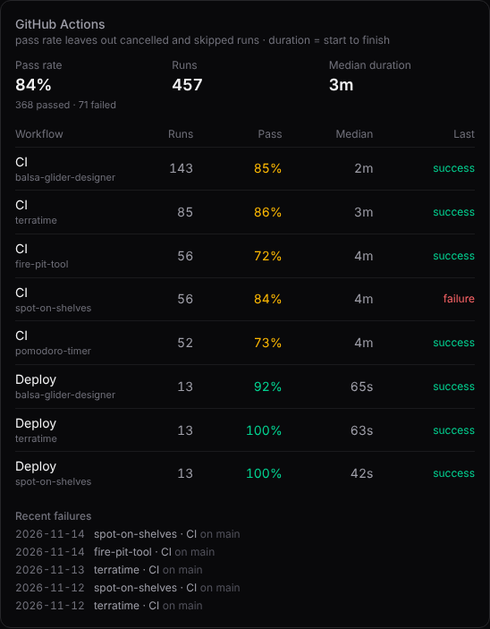</td>
</tr>
<tr>
<td><b>Community health</b> — GitHub's checklist and open Dependabot alerts<br>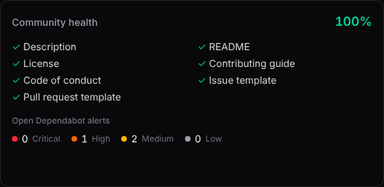</td>
<td></td>
</tr>
</table>

### Repo detail


<table>
<tr>
<td width="50%"><b>Star & fork history</b> — back to repo creation, even before you installed the app<br></td>
<td width="50%"><b>Referrer trend</b> — where traffic comes from, over time<br></td>
</tr>
<tr>
<td><b>Notes & alerts</b> — your notes plus automatically detected events<br></td>
<td><b>Mobile</b><br>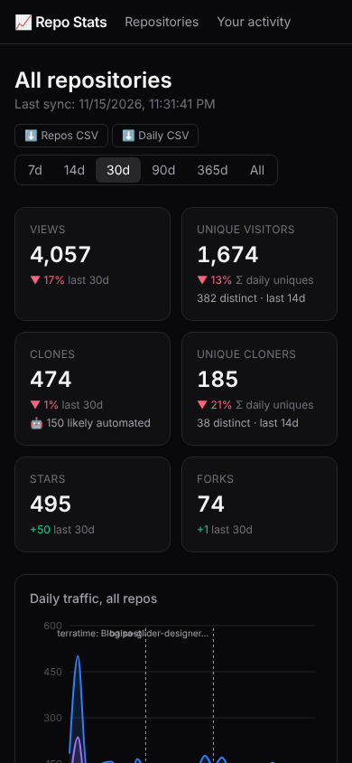</td>
</tr>
</table>

## How it works

GitHub's Traffic API only returns the last 14 days. A daily sync job (`/api/cron/sync`, or `npm run sync`) pulls everything and upserts it into Postgres, so your history keeps growing. The dashboard reads only from the database. After each sync, the alert check looks at yesterday's numbers (the last complete day) and posts anything new to your webhook.

For each of your own repos (forks and archived repos left out) the sync also keeps issues and pull requests, GitHub Actions runs (the last 90 days on the first sync), open Dependabot alerts and GitHub's community profile up to date. After the first sync this is incremental — about three requests per repo per day.

The sync also stores your own contribution history (one GraphQL query per calendar year — the first run backfills every year back to when your account was created, later runs refresh only the current year) and a daily snapshot of your followers.

See [PLAN.md](./PLAN.md) for the architecture, data model and roadmap.

## Setup

1. **Token**: create a [fine-grained PAT](https://github.com/settings/personal-access-tokens/new) with *All repositories*, **Administration: Read-only**, **Contents: Read-only** (release download counts, line counting), **Issues: Read-only** and **Pull requests: Read-only** (issue/PR stats for private repos — public ones work without) and **Metadata: Read-only** (or a classic token with `repo`). Optional: **Actions: Read-only** for CI stats, **Deployments: Read-only** for deploy frequency and **Dependabot alerts: Read-only** for security alerts. Whatever is missing, the sync skips quietly and the panel says which permission to add; everything else works. You can add permissions to an existing fine-grained token without changing its value.
   GitHub is restricting the stargazers list to repo admins and collaborators; when it refuses a repo (403), the sync skips that repo's star *history* and says so. Star counts still update.
2. **Database**: create a Postgres database. [Neon](https://neon.tech)'s free tier works well; Railway, Supabase or a local Docker container work too.
3. **Configure and run**
   ```bash
   cp .env.example .env    # fill in GITHUB_TOKEN, DATABASE_URL, CRON_SECRET
   npm install
   npm run db:migrate      # create tables
   npm run sync            # first data pull; also backfills star/fork history
   npm run dev
   ```

Want to look around before connecting GitHub? Run `npm run seed:demo` to fill the database with fake repos.

## Deploy (Vercel)

1. Import the repo in Vercel and add the variables from `.env.example`. Set `DASHBOARD_PASSWORD`: without it, anyone with the URL can see your stats and add notes.
2. `vercel.json` schedules `/api/cron/sync` daily. Vercel sends `Authorization: Bearer $CRON_SECRET` automatically.
3. **First sync:** run `npm run sync` locally once. It backfills full star/fork history with no time limit.

**Time limits:** the cron route collects traffic for every repo first, because GitHub deletes it after 14 days. It then refreshes star/fork history until its time budget (`SYNC_TIME_BUDGET_MS`, default 45s) runs out, and anything left over resumes on the next run. With very many repos you can also raise `maxDuration` (Vercel Pro) or use the included GitHub Actions workflow (`.github/workflows/sync.yml`). For that workflow, add `GH_STATS_TOKEN` and `DATABASE_URL` as repository secrets.

## Sign in with GitHub (multi-user)

By default the app is single-user: one personal token and an optional password. Set the five `GITHUB_APP_*` / `AUTH_SECRET` variables and it becomes a multi-user site:

1. A visitor signs in with GitHub and installs your **GitHub App** on the repos they choose. It asks for read-only permissions: Administration (GitHub requires it for traffic), Contents, Metadata, Issues, Pull requests, Actions, Deployments, Dependabot alerts, plus Email addresses for future email alerts.
2. They see only the repos of installations they can access: their own account, plus organizations they installed it on. Other people's repos 404, and notes and alert settings can only be changed on your own repos.
3. **Syncing runs on GitHub Actions** (`.github/workflows/sync.yml` → `npm run sync:all`). Each installation is synced with its own token (5,000 requests/hour each, no function time limit), and each user's contributions with their own GitHub token, which is stored encrypted and renewed on every sync. A new user doesn't have to wait for the nightly run: the dashboard starts a first sync (`/api/sync/me`, up to ~4 minutes on Vercel), and the nightly run finishes the rest.
4. Users can delete everything stored about their account from **Account → Delete my data**, after uninstalling the App. `/privacy` explains what's stored.

<table>
<tr>
<td width="50%"><b>Landing page</b> (signed out)<br>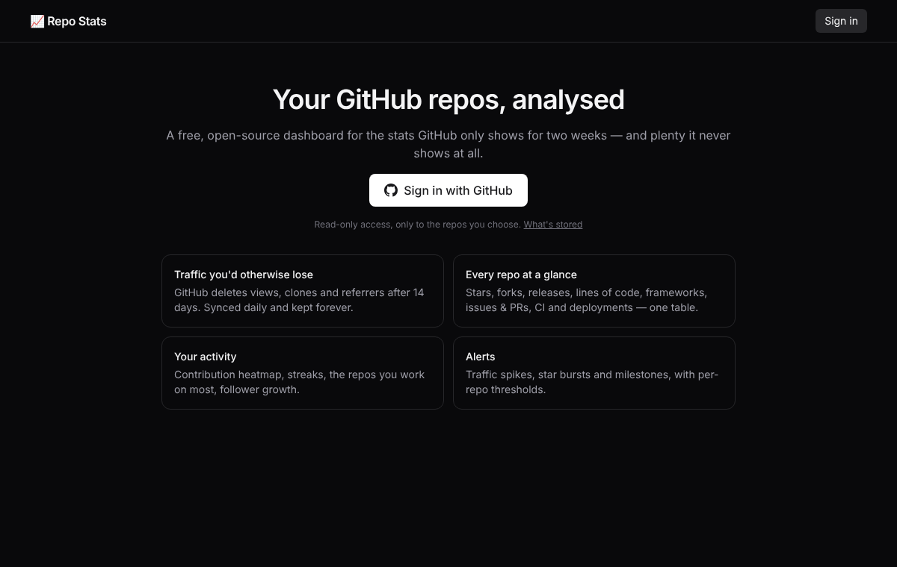</td>
<td width="50%"><b>Account</b> — connected accounts, sync now, delete my data<br>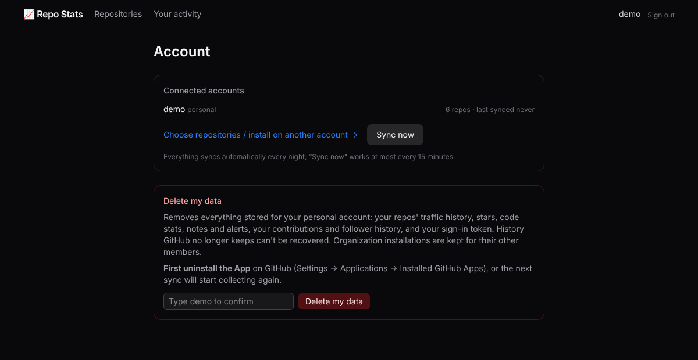</td>
</tr>
</table>

These two are taken in sign-in mode by hand; `npm run screenshots` covers the single-user views.

**Set up the GitHub App** (github.com → Settings → Developer settings → GitHub Apps → New):

| Setting | Value |
|---|---|
| Redirect URI | `https://<your-app>/api/auth/callback/github` (and `http://localhost:3000/api/auth/callback/github` for local dev) |
| Expire user authorization tokens | ✅ |
| Request user authorization (OAuth) during installation | ☐ **off**: people sign in on the site first |
| Setup URL | `https://<your-app>/installed`, with **Redirect on update** ✅ |
| Webhook | off |
| Permissions | the read-only ones listed above |
| Where can it be installed | **Any account** |

Then add the App ID, client ID, a client secret, a private key and `AUTH_SECRET` to Vercel. Add them to the repo's **Actions secrets** too, as `GH_APP_ID`, `GH_APP_PRIVATE_KEY`, `GH_APP_CLIENT_ID`, `GH_APP_CLIENT_SECRET`, `AUTH_SECRET` and `DATABASE_URL`, because GitHub doesn't allow secret names starting with `GITHUB_`. `GITHUB_TOKEN`, `DASHBOARD_PASSWORD` and `CRON_SECRET` aren't used in this mode. Sign-in replaces the password, and the Vercel cron route does nothing. Your existing data carries over: repos are keyed by GitHub id, so they attach to your installation on the first `sync:all`.

## Alerts

After each sync these are recorded for **yesterday**:

| Alert | Fires when |
|---|---|
| Views spike | views ≥ `ALERT_SPIKE_FACTOR` × the trailing daily average **and** ≥ `ALERT_MIN_VIEWS` |
| Clones spike | same rule for clones, with `ALERT_MIN_CLONES` |
| Star burst | ≥ `ALERT_STAR_BURST` new stars in one day |
| Star milestone | crossing 10, 25, 50, 100, 250, 500, 1k, 2.5k, 5k, 10k… stars |

**Per-repo settings:** open *Alert settings* under a repo's *Notes & alerts* to mute that repo, turn its star-milestone alerts off, or give it its own spike factor, minimum views/clones and star-burst size. Blank fields use the global `ALERT_*` values (shown greyed), and *Reset to defaults* removes the override. Changes apply from the next sync.

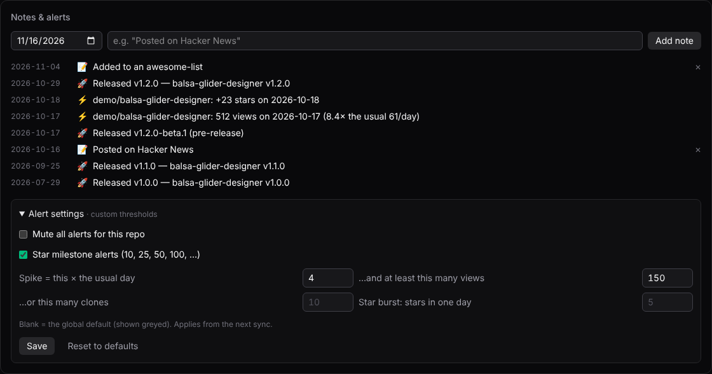

A repo needs a week of stored history before spikes are judged, so a fresh install doesn't flag everything. Alerts appear on the overview, in each repo's *Notes & alerts* list, and as amber markers on the charts. Each alert is recorded only once, even if the sync runs again.

**Slack / Discord:** in sign-in mode only alerts for repos owned by `ALERT_WEBHOOK_OWNER` (your login) are posted, so other users' (possibly private) repo names never reach your channel. Everyone still sees their own alerts in the app. Create an incoming webhook ([Slack](https://api.slack.com/messaging/webhooks), [Discord](https://support.discord.com/hc/en-us/articles/228383668)) and set `ALERT_WEBHOOK_URL`. Set `APP_URL` too if you want each message to link back to the repo page.

## Notes

Use the form on a repo page to pin a note to a date, such as a launch or a blog post. Notes show as grey markers on that repo's charts and on the overview chart. Hover a marker to read it.

**Releases** are marked for you: every published GitHub release (drafts left out) shows as a green 🚀 marker on the repo's charts and in its *Notes & alerts* list, linked to the release page. The overview chart marks your own repos' releases, leaving out pre-releases and forks to stay readable.

## Badges

```markdown

```

| Badge | Example |
|---|---|
| `?metric=views` (`&range=7` → per week, default 30 → per month) |  |
| `?metric=visitors` (GitHub's deduplicated 14-day uniques) |  |
| `?metric=stars` (also `clones`, `forks`) | 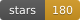 |

Use `&label=…` to change the left-hand text. Badges skip `DASHBOARD_PASSWORD` so GitHub can load them. They only work for **public** repos (private or unknown repos return 404), and are cached for an hour. Set `BADGES_ENABLED=false` to turn them off.

## About lines of code and automated clones

GitHub has no "lines of code" number, so the sync counts them itself: it streams the tarball of each repo's default branch (nothing is written to disk) and counts **non-blank lines** in code files. Left out:

- **Lock files** (`package-lock.json`, `yarn.lock`, `pnpm-lock.yaml`, `Cargo.lock`, `poetry.lock`, `go.sum`, …)
- **Vendored and build output** directories at any depth (`node_modules`, `vendor`, `dist`, `build`, `out`, `.next`, `coverage`, `target`, …)
- **Minified files and source maps** (`*.min.js`, `*.map`, or an average line longer than 300 characters), **binaries**, and files over 1 MB
- **Non-code files**: prose and data such as Markdown, JSON, YAML and plain text. Language comes from the file extension (see `src/lib/loc.ts`)
- Anything your `.gitattributes` marks `linguist-generated`, `linguist-vendored` or `linguist-documentation`. It works the other way too: `dist/** -linguist-vendored` counts a directory back in, and `*.inc linguist-language=PHP` changes the language

A repo is only re-downloaded when its default branch has a new commit, so pushes to other branches cost one API call. Repos larger than 500 MB are skipped. Counting needs the token's **Contents: Read-only** permission. The language bars still show GitHub's Linguist byte counts next to the line counts.

While streaming the tarball the sync also reads dependency manifests — every `package.json` (so monorepos work), `requirements*.txt`, `pyproject.toml`, `Pipfile`, `setup.py`, `Gemfile`, `composer.json`, `go.mod`, `Cargo.toml`, `pom.xml`, `build.gradle` — and notes tell-tale config files (`next.config.*`, `vite.config.*`, `tailwind.config.*`, `Dockerfile`, `.github/workflows/*`, `vercel.json`, `fly.toml`, …). The same pass counts test lines and TODO/FIXME/HACK markers and saves a dated snapshot, so lines of code build up a history from then on. Once a day the sync also asks npm and PyPI for the latest release of each package a framework was detected from (a few dozen public lookups, no token) and flags repos a major version behind (a minor version for 0.x packages). The rules live in `src/lib/frameworks.ts`; add a line there to detect something new. Detection is based on *declared* dependencies, like GitHub's dependency graph: a package that is listed but never imported still counts. Manifests in vendored or build folders are ignored, and when manifests disagree the highest version is shown.

GitHub doesn't say who viewed or cloned a repo, so there is no way to separate people from bots. The 🤖 hint is a heuristic: a repo with at least 10 clones and more than twice as many clones as views in the selected range is flagged, because CI runs, mirrors and deploy hosts (Vercel and Netlify clone on every build) clone without ever opening the page.

## About "unique" numbers

GitHub reports unique visitors per day, and separately, deduplicated over its 14-day window. The big number on the cards adds up daily uniques over the selected range, so someone visiting on 3 days counts 3 times. The "distinct · last 14d" line underneath is GitHub's deduplicated figure from the latest sync.

## Configuration

All variables are listed with comments in [`.env.example`](./.env.example).

| Variable | Required | Purpose |
|---|---|---|
| `GITHUB_TOKEN` | ✅ | Token used to read your repos and traffic |
| `DATABASE_URL` | ✅ | Postgres connection string |
| `CRON_SECRET` | ✅ | Protects `/api/cron/sync` |
| `DASHBOARD_PASSWORD` | recommended | HTTP basic auth for the dashboard and notes (any username) |
| `APP_URL` | | Public URL, for links in alert messages and as the sign-in address (default on Vercel: the production domain, so sign-in from a preview URL goes there) |
| `ALERT_WEBHOOK_URL` | | Slack/Discord webhook for alerts |
| `ALERTS_ENABLED` | | `false` turns alert detection off (default `true`) |
| `ALERT_SPIKE_FACTOR` | | Spike threshold vs trailing average (default `3`) |
| `ALERT_MIN_VIEWS` | | Minimum views for a views spike (default `25`) |
| `ALERT_MIN_CLONES` | | Minimum clones for a clones spike (default `10`) |
| `ALERT_STAR_BURST` | | Stars in one day for a star burst (default `5`) |
| `BADGES_ENABLED` | | `false` disables `/api/badge` (default `true`) |
| `DB_DRIVER` | | `neon` or `pg`. Auto-detected: `*.neon.tech` uses Neon's HTTP driver, anything else uses TCP |
| `DB_POOL_MAX` | | Max TCP connections for non-Neon Postgres (default `5`) |
| `SYNC_TIME_BUDGET_MS` | | Cron sync time budget before deferring history backfills (default `45000`) |
| `GITHUB_APP_ID` | sign-in mode | GitHub App ID — with the four below, switches on *Sign in with GitHub* |
| `GITHUB_APP_CLIENT_ID` | sign-in mode | GitHub App client ID |
| `GITHUB_APP_CLIENT_SECRET` | sign-in mode | GitHub App client secret |
| `GITHUB_APP_PRIVATE_KEY` | sign-in mode | GitHub App private key (the `.pem` contents) |
| `AUTH_SECRET` | sign-in mode | Signs session cookies and encrypts users' GitHub tokens |
| `ALERT_WEBHOOK_OWNER` | | Sign-in mode: only this account's repo alerts go to the webhook |

## Scripts

| Command | What it does |
|---|---|
| `npm run dev` / `npm run build` / `npm start` | Next.js dev server / production build / production server |
| `npm run sync` | Run the collector once (no time limit) |
| `npm run sync:all` | Sign-in mode: sync every GitHub App installation (what the GitHub Actions workflow runs) |
| `npm run db:migrate` | Apply migrations in `drizzle/` |
| `npm run db:generate` | Create a new migration after changing `src/lib/db/schema.ts` |
| `npm run db:push` | Push the schema directly without migrations (prototyping only) |
| `npm run seed:demo` | Fill the database with fake demo repos |
| `npm run screenshots` | Regenerate the screenshots and badge samples in `docs/` (see below) |
| `npm test` / `npm run test:watch` | Unit tests plus integration tests on in-memory Postgres (PGlite) |
| `npm run lint` | ESLint |
| `npm run typecheck` | TypeScript |

## HTTP routes

| Route | Auth | Purpose |
|---|---|---|
| `/` | dashboard password / signed in | Overview (`?range=7\|14\|30\|90\|365\|all`); the landing page when signed out in sign-in mode |
| `/repo/:owner/:name` | dashboard password | Repo detail and notes |
| `/me` | dashboard password | Your contributions, streaks and followers |
| `/api/export` | dashboard password | CSV: `?kind=repos\|daily&range=…` |
| `/api/cron/sync` | `Bearer CRON_SECRET` | Run the sync (Vercel Cron) |
| `/api/badge/:owner/:name` | public (public repos only) | SVG badge |
| `/api/auth/signin` | public | Sign-in mode: start *Sign in with GitHub* (`?next=/path`) |
| `/api/auth/callback/github` | public | Sign-in mode: GitHub's redirect URI |
| `/api/auth/signout` | public (POST) | Sign-in mode: sign out |
| `/api/sync/me` | signed in (POST) | Sign-in mode: sync your installations now (at most every 15 min) |
| `/installed` | public | Sign-in mode: the GitHub App's Setup URL |
| `/account` | signed in | Sign-in mode: connected accounts, sync now, delete my data |
| `/privacy` | public | Sign-in mode: what's stored |

## Development

```bash
npm test && npm run lint && npm run typecheck && npm run build
```

CI runs all four on every push and pull request.

### Keeping the docs current

- `tests/docs.test.ts` fails CI if this README is missing an environment variable from `.env.example`, an npm script, an API route, or a screenshot it links to. Update the README in the same change as the code.
- After UI changes, regenerate the screenshots from demo data so they never show real stats:
  ```bash
  npm run seed:demo && npm run build && npm start   # in one terminal
  npm run screenshots                               # in another
  ```
  This needs a Chromium: run `npx playwright install chromium` once, or set `CHROME_CHANNEL=chrome` to use an installed Chrome.
- Update the roadmap in [PLAN.md](./PLAN.md) when a milestone ships.

## Stack

Next.js 15 · TypeScript · Tailwind CSS v4 · Recharts · Drizzle ORM · Postgres (Neon or any) · Octokit · Vitest + PGlite · Playwright (screenshots)
